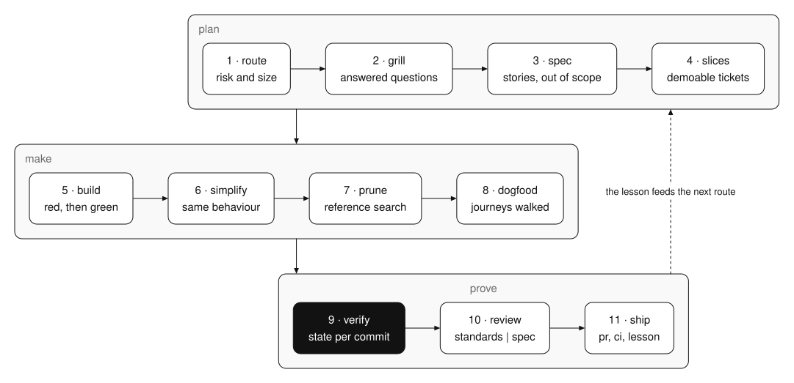
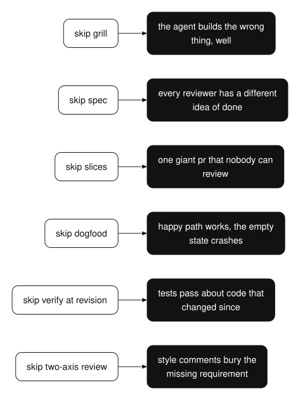

[home](../../README.md) / [build](../README.md)

# most coding-agent failures are skipped stages

most coding-agent failures are not coding failures. they are skipped stages.

the agent builds before anyone agreed on what to build. it reviews a diff nobody read end to end. it ships a change nobody clicked through. it says "all tests pass" about a commit that is no longer the one on the branch. the code in each of those cases might be fine. the process around it was missing a step, and that step is where the bug got in.

i used to fix this with more skills. at one point my clean-code repo had 31 of them, one for each part of the job, and i called them one by one. it worked, but only when i remembered to call the right one. so i stopped treating them as separate tools and made them one loop that runs by default. the loop is the product. the agent is just the thing that runs it.

## the loop

eleven stages. each one has a gate, and each gate leaves something you can look at later.

1. **route the work.** classify the change: what type it is, how risky, how vague, and which boundaries it crosses. then size the ceremony to fit. a one-line fix does not need a spec. a change to billing does.
2. **grill the request.** build a tree of the open design questions. ask the whole current set in one round, with your recommended answer next to each question. never ask the person for a fact you can find yourself in the code.
3. **write the spec.** a problem statement, the solution, numbered user stories, the implementation decisions, the testing decisions, and what is out of scope.
4. **cut vertical slices.** each slice is a narrow path through every layer: schema, api, ui, tests. each one works on its own, you can demo it, and it fits in one fresh context window.
5. **build one slice at a time.** red test, the smallest change that turns it green, repeat. run the typecheck and the affected test file often. run the full suite once at the end.
6. **simplify without changing behaviour.** reuse the utilities the repo already has. remove state you don't need. flatten deep conditionals. delete dead code and unused imports. fewer lines is not the goal. faster reading is.
7. **prune.** run the repo's own dead-code detector. confirm every candidate with a reference search before you delete it. leave exports, routes, reflection, dependency injection and generated code alone.
8. **dogfood the diff.** walk every user journey the change touches, as each kind of user, including the error, empty, boundary and permission branches. log paper cuts apart from real failures.
9. **verify at the revision.** run the checks the repo declares. tie every result to the commit it ran on. use one of seven states: pass, fail, not run, not available, not configured, stale, error. never turn missing evidence into a pass.
10. **review on two axes.** one review asks "does this meet our standards?". the other asks "does this do what the spec says?". run them in parallel and report them side by side. don't rank one against the other.
11. **ship.** commit, push, open a pr in plain english, watch ci, check the deployed result, and write down what you learned.



*the eleven stages. every dot is a gate, and every box names the evidence its stage leaves behind.*

## why the gates matter more than the stages

anyone can list stages. the value is in what each gate refuses to let through.

the grill stage refuses to start a build while a design question is still open. the slice stage refuses a ticket that only touches one layer, because a backend-only ticket can pass every test and still be useless. the verify stage refuses a pass that ran on an older commit. the review stage refuses to blend "is it clean" with "is it right", because a clean diff that solves the wrong problem should fail, and a correct diff with a style issue should not.



*what goes wrong when a gate is missing.*

## the seven states

the verify stage is the one i'd keep if i could only keep one.

most reports have two states: it passed, or it failed. real life has more. a check can be missing from the repo. it can exist but not be set up. it can have run on yesterday's commit. it can crash before it says anything. if your report squeezes all of that into "pass", the report is lying, and nobody can tell.

so every check gets one of seven states, and every state is tied to a commit. "not run" is a perfectly honest answer. "pass" with no commit next to it is not.

## right-size it

this does not mean every typo gets a spec and a two-axis review. the first stage exists to stop that. a small change is three steps: look, change, check. you add stages as risk and size go up. what you never drop is the last part: a check you ran, on this commit, with its real state.

## install the skill

i packaged the loop as a skill. it routes the work, asks the open questions in one round, writes the spec and the slices, and builds one slice at a time. it simplifies, prunes, dogfoods and verifies at the revision, runs the two-axis review, and writes the pr. it stops before merge. install it in claude code with the two commands below, or paste the prompt into any agent that reads skills.

**claude code**

```text
/plugin marketplace add shashank-sn/workflows
/plugin install delivery-loop@shashank-workflows
```

**any other agent**: paste this prompt.

```text
install the agent skill at https://github.com/shashank-sn/workflows/tree/main/build/delivery-loop/skills/delivery-loop
copy that whole folder into your skills directory (for claude code: ~/.claude/skills/delivery-loop), read its SKILL.md, and use it on: <your task>
```

[read the skill files](skills/delivery-loop/SKILL.md) · [ask a question](https://github.com/shashank-sn/workflows/issues/new?title=delivery-loop) · [all build workflows](../README.md) · [home](../../README.md)
