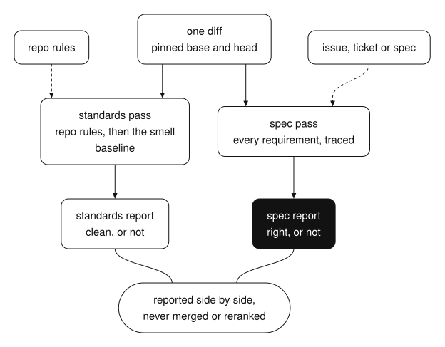
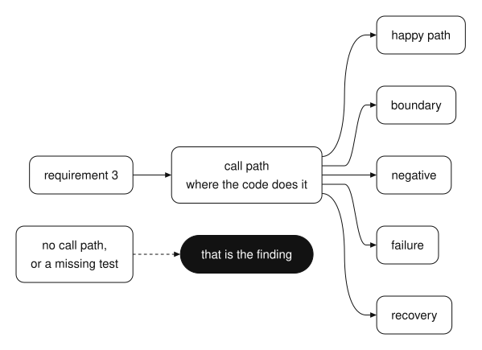

[home](../../README.md) / [build](../README.md)

# a change can follow every standard and still be the wrong change

a change can follow every standard in the repo and still implement the wrong thing.

i've seen that diff. it followed every standard in the repo and implemented the wrong behaviour. nothing about its style gave it away.

most review asks two questions at once and answers neither well. "is this good code?" and "is this the right code?" sound close. they need different inputs. the first needs the repo's rules. the second needs the spec. put both in one pass and the reviewer drifts toward whichever one is easier to see, which is almost always style.

so split them.

## two passes, two reports

the standards pass asks: does this change follow the repo's documented conventions, plus a baseline of known smells?

the spec pass asks: does this change do what the issue, ticket or spec says, no more and no less?

run them as two separate reviewers, each with its own context, so one can't colour the other. a change can pass one axis and fail the other. that's the point. you want to see "clean, but wrong" and "right, but messy" as two different results, not one blurred score.



*you run two passes on one diff, each with its own inputs. a change can pass one and fail the other, so the reports stay apart.*

## the process

1. **pin the fixed point.** a commit, branch, tag or merge-base. confirm it resolves and the diff isn't empty.
2. **find the spec.** an issue reference in a commit message, a path you were given, or a spec file that matches the branch name. if there's no spec, skip the spec pass and say so in the report.
3. **list the changed files.** record the base and final revisions.
4. **run the standards pass.** the repo's own rules first, then the smell baseline. skip anything the tooling already enforces.
5. **run the spec pass.** map every requirement to a call path, then to a happy-path, boundary, negative, failure and recovery test.
6. **report side by side.** separate headings. never merge the findings, and never rerank one axis against the other.
7. **write each finding the same way.** exact location, what goes wrong because of it, severity, confidence, the smallest fix that would close it, and what you decided.
8. **keep blocking findings blocking.** "we accept the risk" doesn't turn a blocker into a note.
9. **review again after fixes.** a fix changes the revision, so both passes run again.

## the smell baseline

the standards pass needs something to check beyond house rules. twelve smells cover most of what a reviewer catches by eye: mysterious name, duplicated code, feature envy, data clumps, primitive obsession, repeated switches, shotgun surgery, divergent change, speculative generality, message chains, middle man, refused bequest.

a smell is only a finding if you can say what it costs in this change. "this name is vague" is taste. "this name hides that the function also deletes the record" is a finding.

## why the spec pass is the one that saves you

style problems are visible. a reviewer scrolls past a 200-line function and feels it. a missing requirement leaves nothing to scroll past. the code that isn't there doesn't look wrong.

so the spec pass maps requirements to call paths and tests, one by one. it turns "does this look right?" into "where is requirement 3, and which test proves it handles the empty case?" if there's no answer, that's the finding.



*you trace each requirement to the code that does it, then to five kinds of test. a gap anywhere on that path is the finding.*

## install the skill

i packaged this as a skill. give it a repo, a base and a head revision, and a spec if you have one. it pins the diff, lists the changed files, runs both passes and writes two reports with a finding table and the worst issue per axis. it is read-only. it never edits product code, never picks a single winner across the axes, and never invents findings to fill a quota. install it in claude code with the two commands below, or paste the prompt into any agent that reads skills.

**claude code**

```text
/plugin marketplace add shashank-sn/workflows
/plugin install two-axis-review@shashank-workflows
```

**any other agent**: paste this prompt.

```text
install the agent skill at https://github.com/shashank-sn/workflows/tree/main/build/two-axis-review/skills/two-axis-review
copy that whole folder into your skills directory (for claude code: ~/.claude/skills/two-axis-review), read its SKILL.md, and use it on: <your task>
```

[read the skill files](skills/two-axis-review/SKILL.md) · [ask a question](https://github.com/shashank-sn/workflows/issues/new?title=two-axis-review) · [all build workflows](../README.md) · [home](../../README.md)
