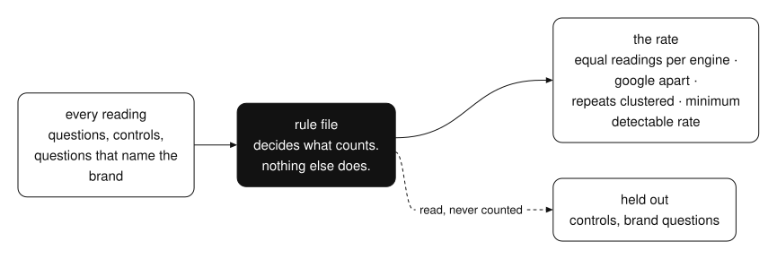
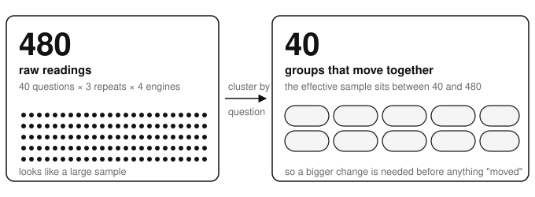

[home](../../README.md) / [research](../README.md)

# the fastest way to fake progress is to change the measurement

the fastest way to fake progress is to change the measurement and call it a trend.

nobody does it on purpose. you add a new engine to the tracker, so this month has more readings than last month. you add a few questions that mention the brand by name, and of course the brand shows up in those answers. the number goes up. the work didn't change. the instrument did.

i built a measurement for how often a company shows up in ai answer engines. it's about as noisy a system as you can pick: the answers move every day, every engine works differently, and the same question asked twice can give two different answers. the protocol below is what kept the numbers honest. it works for any system that moves while you measure it.

## eight rules

1. **one rule file decides what counts.** the models, the number of repeats, the controls, the brand pattern, the hosts the company owns, the controls you retired. nothing downstream decides for itself. if a script has its own idea of what a brand mention is, you have two measurements.
2. **equal readings per engine per question.** no engine gets double weight because it has more tiers or you happened to run it more often.
3. **hold controls out of every rate.** a control is a question where you know the answer shouldn't change. if the control moves, the instrument moved, not your work.
4. **hold out questions that contain the brand.** if the question names the company, the answer will too. that proves nothing about visibility.
5. **never pool google with the assistants.** a search result page and a chat answer are different questions, so they get different numbers.
6. **cluster repeats by question.** three readings of one question are not three independent draws. they're one question, read three times.
7. **report the minimum detectable rate.** not just today's number. tell people the smallest change this setup can see. a jump smaller than that is noise.
8. **write down what the measurement can't see.** every instrument has blind spots. if you don't list them, someone will read the number as covering them.



*controls and brand questions are read, but never counted. the rate comes only from what's left.*

## the process

1. write the question the measurement answers, in one sentence.
2. write the rule file.
3. build the question set from real demand: what buyers search for and ask, not what a team brainstormed in a room.
4. collect equal readings per engine per question.
5. hold controls and brand questions out of every rate.
6. cluster repeats by question and report the effective sample size.
7. compute the minimum detectable rate.
8. record what the measurement can't see.
9. publish the method next to the numbers, and treat the method as the source of truth.
10. run a calibration before any expensive run.

step 10 is the one people skip. a calibration is a small, cheap run that checks the instrument before you spend money on the real one. it catches the broken parser, the engine that changed its output format, the control that stopped being a control. you find those at the cost of a small run, not after the full one.

## why the effective sample size matters

say you ask 40 questions, three times each, on four engines. that looks like 480 readings. it isn't 480 independent data points. the three repeats of one question move together, because they're the same question. after clustering, you have far fewer real draws than the raw count suggests. that means a bigger change is needed before you can say anything moved.

so you report the minimum detectable rate. if your setup can only see changes of ten points or more, a five-point jump is not a win. it's weather.



*480 readings look like a lot. clustered by question, they are 40 groups that each move together.*

## publish the method with the number

a number with no method is a claim. a number with the method next to it is something a reader can check.

so the rule file is not an internal detail. it ships with the report. anyone who wants to know why this month's rate is what it is can read exactly what was counted, what was held out, and what the instrument can't see. if the method changes, that's a new baseline, not a trend.

## install the skill

i packaged this as a skill. it writes the rule file with you, plans equal readings, holds out controls and brand questions, and clusters repeats. it computes the minimum detectable rate and runs a calibration before the expensive run. it refuses to report a rate without a denominator, and it won't pool search with chat answers. install it in claude code with the two commands below, or paste the prompt into any agent that reads skills.

**claude code**

```text
/plugin marketplace add shashank-sn/workflows
/plugin install measurement-protocol@shashank-workflows
```

**any other agent**: paste this prompt.

```text
install the agent skill at https://github.com/shashank-sn/workflows/tree/main/research/measurement-protocol/skills/measurement-protocol
copy that whole folder into your skills directory (for claude code: ~/.claude/skills/measurement-protocol), read its SKILL.md, and use it on: <your task>
```

[read the skill files](skills/measurement-protocol/SKILL.md) · [ask a question](https://github.com/shashank-sn/workflows/issues/new?title=measurement-protocol) · [all research workflows](../README.md) · [home](../../README.md)
